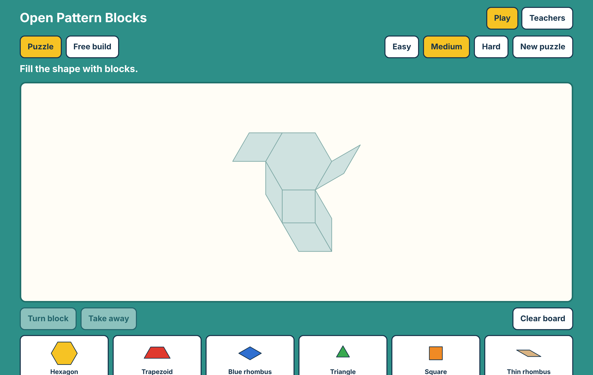

# Open Pattern Blocks

**Free pattern blocks for every classroom.** Children build and solve puzzles on any
device. Teachers print real-size class sheets in seconds.



## Why this exists

Pattern blocks teach shape, fractions, symmetry and spatial reasoning. Not every
classroom has enough physical sets, and many digital tools need accounts, subscriptions
or a fast connection. Tools used by children should also collect as little as possible.

Open Pattern Blocks is a free alternative that runs in a browser. It has no accounts, ads
or tracking.

## What works today

**For children**

- Solve generated puzzles at three levels, by dragging blocks with a finger or a mouse.
- Solve a shape with any correct blocks. Six triangles can replace a hexagon.
- Build freely in Free build.
- Use blocks that snap together and turn in steps of 30°.

**For teachers**

- Make up to 30 sheets, with or without answer pages, in Letter or A4.
- Print designs at actual size for standard blocks with one-inch sides.
- Choose block outlines, a shape outline, or full colour.
- Include a counting strip on each sheet.
- Repeat a set exactly by reusing its set number.
- Add a Free build design as a sheet.
- Share a design with a puzzle code. Codes hold shapes only.

## Run it

Requires Node.js 20 or later.

```sh
npm install
npm run build
```

Open `dist-web/index.html` in a browser. It is one file and works offline.

To run the checks:

```sh
npm test
npm run typecheck
```

## How it is built

| Part | What it does |
| --- | --- |
| `src/core/shapes.ts` | Exact geometry of the six standard blocks |
| `src/core/generator.ts` | Seeded puzzle generator, with optional mirror symmetry |
| `src/core/play.ts` | Snapping and the solved check |
| `src/core/pdf.ts` | Real-size PDF class sheets, with no dependencies |
| `src/core/code.ts` | Puzzle codes, which are fully validated when opened |
| `web/` | Play and teacher screens |

The app has no runtime dependencies and makes no network requests.
See [the architecture notes](docs/architecture.md).

## Privacy

The app does not collect personal data. See [PRIVACY.md](PRIVACY.md).

## Project status

This is an early release. It has not yet been tried in a classroom, so feedback from
teachers is the most useful contribution right now. Please check a printed sheet against
your own blocks before printing a full class set.

See [ROADMAP.md](ROADMAP.md) for what comes next.

## Contributing

Teachers, parents, designers, translators and developers are all welcome. See
[CONTRIBUTING.md](CONTRIBUTING.md).

## License

[Apache License 2.0](LICENSE)
